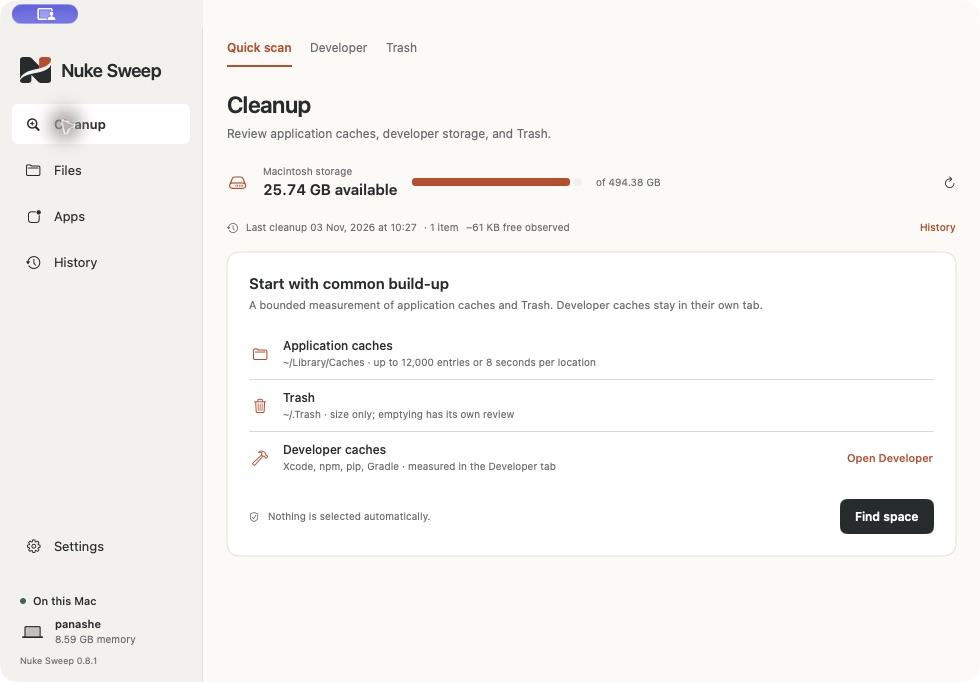
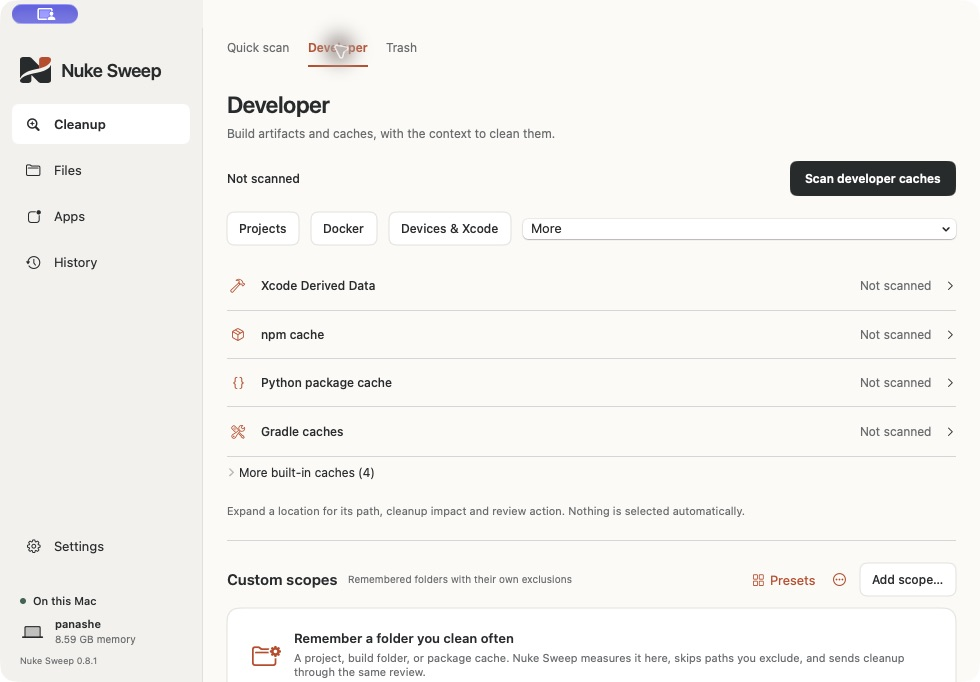

<p align="center"></p>
<h1 align="center">Nuke Sweep</h1>
<p align="center">Make room for what’s next.</p>
<p align="center">A native macOS cleanup utility for developers, by Zyncraft.</p>
<p align="center"><a href="https://sweep.zyncraft.com">Website</a> · <a href="https://github.com/emacliam/nuke-sweep/releases/latest">Download</a> · <a href="#install">Install</a> · <a href="#build-from-source">Build</a> · <a href="https://github.com/emacliam/nuke-sweep/issues">Report an issue</a></p>



Nuke Sweep tells a developer what is safe to clear and what clearing it will cost them, before anything is deleted. It is for the person whose Mac is nearly full of caches, dependencies, build output, simulators and container layers, and who knows roughly what is using the disk but does not dare touch it.

Reviewed items move to Trash with a receipt and a way back. Nothing is selected for you, and every item is rechecked at the moment it moves.

**New in 0.9.0:** a one-button check of the whole Mac that ends on how much can be cleared and how much of that regenerates by itself; rebuild cost and last-use shown per item; a warning that holds back anything with no copy anywhere else (not regenerable and not in Time Machine scope); a check that Put Back will work before items move; an optional weekly check that notifies when clearable space has grown and names the locations that grew; a low-storage alert that runs the check first and says what grew and what can go; a first-run walkthrough for Full Disk Access, with a notice when a result is a lower bound without it; an opt-in automatic cleanup, described below; and a search of your own files during the check, also described below. The source also drops four things that were a system monitor's job rather than a cleanup tool's: the Processes and Startup pages, the in-app Widgets page, the live single-folder watch and the sustained-CPU alert. Scheduled folder scans remain, under Files → Schedules.

**0.9.0 release candidate.** The public download is listed on the website after release verification. See [known limitations](#known-limitations).

## Download

[**Download Nuke Sweep for Mac**](https://sweep.zyncraft.com/#download)

- **Requirements:** macOS Sonoma 14 or later, **Apple silicon** (M-series Mac).
- **Distribution:** Developer ID signed, notarized by Apple, and stapled for offline ticket verification.
- **No account required.** The app works with local files and keeps its scan history on your Mac.
- This download does **not** include an Intel binary. Source builds are available for development on compatible Macs.

Apple notarization checks malware and signing requirements; it is not a review of every cleanup decision or a guarantee that any file is disposable.

## Install

1. Download and open the Nuke Sweep DMG.
2. Drag **Nuke Sweep** to the **Applications** shortcut.
3. Eject the disk image, then open Nuke Sweep from Applications.
4. Start in **Cleanup** to measure common build-up, or **Files** to select a folder.
5. Inspect the results, select the items you understand, and read the review before confirming cleanup.

If upgrading from Nuke, quit the older app and keep only the version you intend to use in Applications. The display name changed; bundle identifiers, saved preferences, URL scheme, widget kinds, and the local data folder are retained so your settings and history continue to work.

### Folder access

macOS may deny access to protected folders. Select a narrower readable folder or use **Settings → Permissions & access**. When you need protected locations, open **System Settings → Privacy & Security → Full Disk Access**, add the installed Nuke Sweep app, then quit and reopen it. The app cannot grant itself access.

Incomplete scans remain labeled, and cleanup is unavailable for incomplete locations. Granting access never selects files for removal.

### Menu bar and desktop widget

The optional menu-bar tool shows available storage, CPU, or estimated VM memory. Closing the main window keeps it running while monitoring is enabled; choose **Quit Nuke Sweep** to stop it.

For the Storage widget, launch the installed app once, then Control-click the desktop → **Edit Widgets** → search **Nuke Sweep** → choose **Storage**. macOS controls widget refresh timing; the menu-bar monitor provides current readings.

## What it does

| Tool | Use it for |
| --- | --- |
| Cleanup | Measure common application caches and Trash; review before acting. |
| Files | Inspect folder sizes, drill into a folder tree, compare complete scans, schedule measurements and switch between mounted volumes. |
| Developer | Inspect Xcode, npm/pnpm/yarn/bun, pip/uv/Poetry, Cargo, Maven, NuGet, Gradle, CocoaPods, Go, SwiftPM, Homebrew, Hugging Face, simulator and device-support caches; detect JavaScript/Bun/Deno, Rust, Swift, Go, Python, Flutter/Dart, Java/Kotlin and .NET workspaces with grouped rebuild guidance and possible-active hints from commands, listening-process working directories and development-process working directories; review build output and custom scopes with exclusions. |
| Apps | Inspect installed applications and bundle-identifier related-file candidates. |
| Duplicates | Compare size, SHA-256, and file contents; choose a keeper before reviewing extra copies. |
| Docker | Inspect the selected CLI context, local VM disk, and a read-only volume inventory. Volumes are never pruned. |
| Devices and local models | Review archives, backups, Android snapshots, simulator devices, and known or explicitly chosen local model locations. |
| Monitor | Optional storage, CPU, and VM-memory readings in the menu bar, and permission-gated low-storage and growth alerts. |
| History | Local cleanup receipts with outcomes, export, and restoration guidance. |
| Scheduled scans | Measure a chosen folder hourly, daily or weekly while Nuke Sweep is open; optional quiet hours and finish notifications; results join Growth history. Never cleans automatically. |
| Diagnostics | Local-only hang samples, macOS crash-report access, and a redacted JSON support bundle export. |
| Appearance | System, Light or Dark appearance for the main window and menu-bar tool; adaptive contrast rather than a forced light theme. |
| Keyboard | File-tree navigation (arrows, Space, Return), filter focus with ⌘F, and native table/picker navigation. See [keyboard and accessibility notes](docs/ACCESSIBILITY.md), [scheduled scans](docs/AUTOMATION.md) and [mounted volumes](docs/VOLUMES.md). |
| AI assist | Optional and off by default. “Explain with AI” for tree and review items, a reviewed “Draft with AI” plan with diff/confirmation/undo, optional scope exclusions and **Save as scope**, and a two-scan growth explanation. Provider manager for local, DeepSeek, Anthropic, Gemini and OpenAI-compatible endpoints, with per-provider Keychain keys, Test connection, persisted model discovery, optional Plan-provider routing and offline-only blocking. No file contents, no execution. Responses are size-capped and plan output is restricted to measured names. |




## Cleanup with context

- Nothing is selected or cleaned automatically unless you switch on the automatic cleanup.
- The check also lists your own surplus files, in eighteen groups: installers for apps already installed, device firmware, unfinished downloads, repeat downloads confirmed byte for byte, archives already unpacked, Mail attachment copies, video-editing render files, logs, old downloads, screen and meeting recordings, old screenshots, large video and audio, disk images and virtual machines, device backups, Xcode archives, phone app packages, and very large files untouched for six months. Each is listed with the reason it was listed. None of these is ever ticked for you or touched by the automatic cleanup, and they are kept out of the "comes back by itself" figure. Photo libraries, mail, messages, cloud-synced folders and cloud-only placeholders are not searched.
- Build and dependency folders in projects outside your chosen code folder (a checkout on the Desktop or in Downloads) are measured and ranked with the rest. The automatic cleanup leaves them alone, because their repository state is not checked.
- The automatic cleanup is off by default and offered only alongside the weekly check. It moves to Trash only caches, dependency folders and build output that were neither read nor written for the number of days you choose (30, 90 or 180), that nothing is using, and that do not sit beside uncommitted work. Each run passes the same checks as a reviewed cleanup, leaves a receipt that can put items back, and never empties Trash. Before you switch it on, the app shows what it would move right now.
- Normal file cleanup moves reviewed items to **macOS Trash**. Restore with Finder’s Put Back when available, or move the item back to its original location.
- Source-control metadata, credential stores, personal data stores, and source-looking project roots are protected by cleanup guards.
- The review rechecks identities and measurements. Unknown ownership and permission gaps remain explicit.
- **Simulator deletion, emptying Trash, and Docker pruning are permanent**, separately reviewed actions.
- Moving something to Trash normally does not free its occupied space. APFS snapshots, shared extents, and other system activity can also affect available space.

These guards reduce risk; they cannot prove that every arbitrary folder is safe to remove. Close apps or builds using selected files and review unfamiliar locations in Finder.

## Privacy

Scan history and receipts are local JSON under `~/Library/Application Support/Nuke`. The older directory name is intentional for upgrade compatibility. Records can contain local paths, process names, and CLI output. JSON export happens only when you choose an export destination.

The app has no account flow and no analytics or advertising SDK. Widgets read system metrics independently without personal scan history. Docker uses your existing CLI and selected context, which may point to a remote engine.

AI assist is off by default and makes no request at launch. The local provider talks only to an HTTP loopback endpoint on this Mac. Cloud providers are explicit; each requires its own key in the login Keychain and an HTTPS endpoint. They receive metadata (relative names, sizes and Nuke’s evidence), never file contents, source, `.env`, receipt paths or absolute home paths. AI suggestions are advisory and cannot select, move or delete files.

[Read the privacy explanation](https://sweep.zyncraft.com/privacy).

## Verify the download

Download [SHA256SUMS.txt](https://sweep.zyncraft.com/downloads/SHA256SUMS.txt) beside the DMG and run:

```sh
shasum -a 256 -c SHA256SUMS.txt
```

You can also check Apple’s signature and approval:

```sh
spctl -a -t open --context context:primary-signature -vv Nuke-Sweep-0.9.0.dmg
```

Expected: `accepted`, `source=Notarized Developer ID`.

## Build from source

Requires macOS 14+, Xcode with a compatible Swift 6 toolchain, and Python 3 for ICNS packaging. There are no third-party Swift dependencies.

```sh
git clone https://github.com/emacliam/nuke-sweep.git
cd nuke-sweep
./scripts/build-app.sh
open "dist/Nuke Sweep.app"
./scripts/test.sh
```

The default build is ad-hoc signed for local development. To create a distribution build, supply your own Developer ID identity and notarization profile:

```sh
export NUKE_SIGN_IDENTITY="Developer ID Application: YOUR ORGANIZATION (TEAMID)"
export NUKE_NOTARY_PROFILE="your-notary-profile"
./scripts/build-app.sh
./scripts/build-dmg.sh
```

Do not put credentials or private keys in the repository. See [distribution notes](docs/DISTRIBUTION.md) for the signing and stapling workflow.

### Continuous integration

`scripts/ci.sh` runs the build, full test suite, ad-hoc packaging and signature verification locally. `scripts/verify-release.sh` checks signatures, widget signature, architecture, Gatekeeper, stapling, DMG checksum and SHA-256; use `--strict` to fail the release check. The GitHub Actions workflow calls the same script.

Light/dark visual regression for AI settings (off/on), Files, Projects, History, Growth, Developer and Docker is available with `./scripts/check-snapshots.sh`; baselines live in `snapshots/baseline`. It needs a GUI session, so it is a local check rather than a headless CI step. See [SNAPSHOTS.md](docs/SNAPSHOTS.md).

### Repository layout

```text
Sources/Nuke/          Native application
Sources/NukeMetrics/   Shared system measurements
Sources/NukeWidgetUI/  Widget faces and shared brand geometry
Widgets/              Embedded WidgetKit extension
Tests/                Existing safety, scanning, and behavior tests
branding/nuke-sweep/   Approved logo and app icon assets
scripts/              Build, packaging, and diagnostic helpers
website/              Static showcase deployed to Vercel
```

### Website development

The site is buildless HTML, CSS, and JavaScript with self-hosted fonts and real app screenshots.

```sh
python3 -m http.server 4173 --directory website
```

Open `http://localhost:4173`. The Vercel project uses `website` as its root. Download files are versioned, signed release artifacts; update the DMG, checksum, release copy, and links together. See [website deployment notes](website/README.md).

## Developer cleanup improvements

Version 0.8.2 adds partial batch reviews, cache-content review, deeper project discovery with large node_modules filters, Android snapshot cleanup, and confirmed simulator deletion. See the [developer cleanup guide](docs/DEVELOPER-CLEANUP.md) for bounds, recovery, and emulator details.

## Known limitations

- An intermittent UI freeze was reported in 0.8.2 and its cause was never captured in the field. The current source fixes one confirmed cause — opening an AI assist view read every stored API key from the Keychain on the main thread, which hung the window whenever macOS was slow to answer or showed its access prompt, and saving or removing a key did the same — removes two other likely ones, and adds a latency gate to CI: a run over 120,000 files and 10,000 duplicate pairs, paging through results during the comparison, kept the main thread's worst stall under 400 ms. That is evidence against the freeze on that workload, not proof it is gone. If the app stops responding, Settings → General can capture a local sample automatically, or use [the manual hang capture guide](docs/HANG-DIAGNOSTICS.md). Review diagnostics for private information before sharing.
- Scans are bounded and do not follow symlinks or cross filesystem boundaries. Logical and allocated totals can double-count shared storage; they do not promise reclaimable bytes.
- Related application files and leftover matches are candidates, not proof of exclusive ownership.
- The desktop widget in the 0.8.2 download is expected not to load. Its extension was linked to start at `main` rather than the extension entry point, so it traps when macOS launches it to ask what widgets it offers, and the Storage widget never reaches the gallery. The source now links it with `-e _NSExtensionMain` and both `scripts/ci.sh` and `scripts/verify-release.sh` fail a build that does not. The fix has not yet been observed in the widget gallery on a signed build; that check belongs to the next release.
- macOS permissions, widget discovery, and refresh schedules remain under system control.
- Intel support and privileged cleanup are not included in the distributed binary.

## Issues and source use

Report reproducible problems through [GitHub Issues](https://github.com/emacliam/nuke-sweep/issues). Include macOS version, Mac model, app version, and the steps that caused the issue. Remove private paths, credentials, and sensitive logs before posting.

Source is available for inspection. No open-source license is granted by this repository; all rights are reserved by Zyncraft Technologies. Bundled Instrument Sans is distributed under its [SIL Open Font License](website/assets/FONT-LICENSE.txt).
